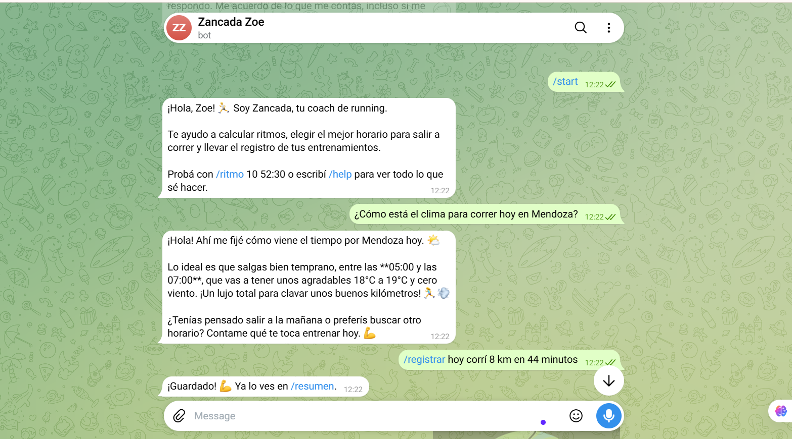
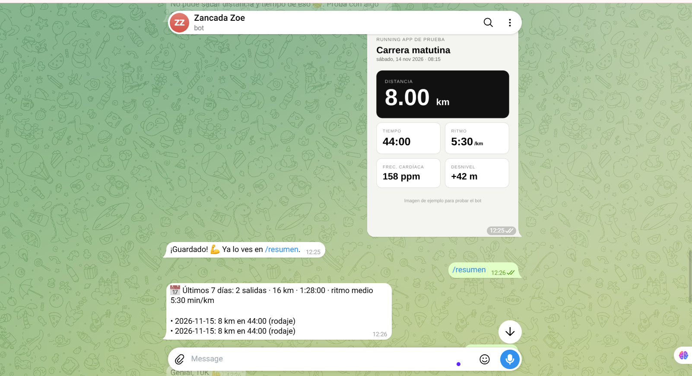
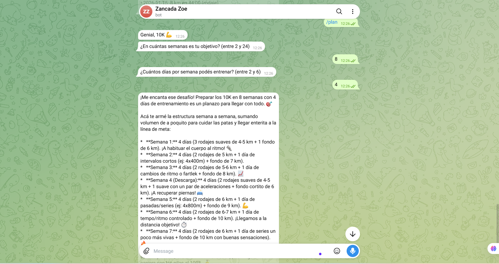
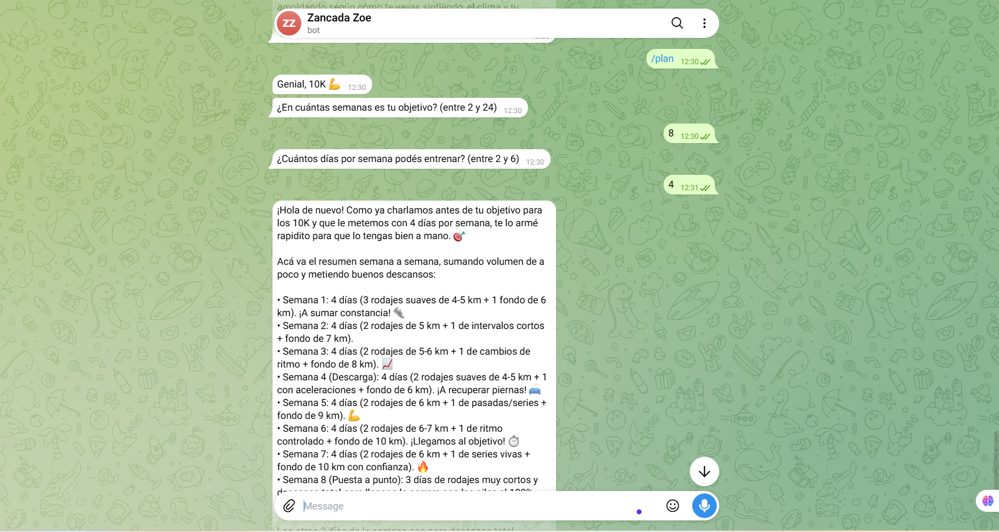

# InformeEGIfinal · Zancada: coach de running con IA

**Trabajo Integrador Final (TIF)** · Sistemas Inteligentes Aplicados 2026 · ITU UNCUYO · Docente: Ing. Miguel Pérez Díaz
**Fecha:** 15/11/2026
**Código:** [github.com/ZogeGBR/zancada](https://github.com/ZogeGBR/zancada) (rama `main`)

**Integrantes:** Zoe Garcia Badiola, Ignacio Morichetti Ramal, Matias Lopez, Gonzalo Laspada y Luciano Malanca. El equipo trabajó sin roles fijos: todos participaron en el desarrollo, las pruebas y la preparación de la defensa.

---

## 1. Resumen y problema que resuelve

**Zancada es un bot de Telegram que actúa como coach de running: calcula ritmos, consulta el clima real para elegir el mejor horario de salida, registra entrenamientos y arma planes, recordando a cada corredor entre conversaciones.**

Los corredores amateurs entrenan sin entrenador: improvisan ritmos, no registran lo que hacen y deciden la salida sin mirar el clima. Las apps de entrenamiento suelen ser rígidas o de pago, y un chat genérico con un LLM no recuerda al usuario ni accede a datos reales. Zancada combina un modelo de lenguaje (Gemini) con herramientas propias, una base de datos y un flujo guiado, en el canal que el corredor ya usa todos los días.

El proyecto evolucionó en tres entregas: v1 (comandos), Hito 2 (Gemini sin estado y memoria en SQLite, ver [INFORME_HITO2.md](INFORME_HITO2.md)) y este TIF (function calling, salida estructurada, multimodalidad y flujo guiado).

## 2. Objetivos y alcance

**Objetivo general:** diseñar, implementar y defender un sistema inteligente real que un corredor pueda usar desde Telegram sin instalar nada.

Objetivos específicos:

- Conversar con una personalidad estable (prompt de sistema) y recordar al usuario aunque el bot se reinicie.
- Resolver con datos reales lo que un LLM no puede saber: el clima de hoy (Open-Meteo) y los entrenamientos del propio usuario.
- Convertir texto libre y fotos de relojes en datos estructurados y validados, siempre con confirmación del usuario antes de guardar.
- Guiar al usuario en un flujo de varios pasos para armar un plan de entrenamiento.
- Fallar con elegancia: cuota agotada, clave inválida, API externa caída o respuestas malformadas no rompen la conversación.

**Fuera de alcance:** diagnósticos o consejos médicos, pronósticos de más de un día, integración con relojes GPS, pagos y despliegue en un servidor permanente (hoy corre en la máquina del equipo con `python bot.py`).

## 3. Arquitectura y decisiones de diseño

```
Corredor (Telegram) <-> bot.py <-> llm.py <-> Gemini (Interactions API)
                          |           |
                          |           +-> tools.py -> Open-Meteo (clima)
                          |                   |
                          +------------> SQLite (db.py): mensajes, entrenamientos
```

El bot es el único que habla con Telegram, la base y las APIs: Gemini solo pide ejecutar herramientas y recibe sus resultados. Decisiones clave:

- Gemini se usa **sin estado** (`store=False`) y el historial vive en SQLite, para controlar el contexto y poder borrarlo.
- La lógica de dominio (`dominio.py`) no depende de Telegram ni de Gemini, así que se prueba sola.
- Todo dato que Gemini devuelve se valida antes de guardarse.
- Telegram se usa en texto plano: el prompt prohíbe el Markdown y `bot.py` limpia los asteriscos por si el modelo los usa (ver sección 6).

## 4. Cumplimiento de los requisitos de la materia

Zancada cubre los seis requisitos obligatorios y dos módulos avanzados. Los requisitos se tomaron de las clases 1 y 2 y de los hitos; no hay rúbrica oficial del TIF.

| Requisito | Cómo lo cumple Zancada | Dónde |
| --- | --- | --- |
| 1. Comandos de Telegram | `/start`, `/help`, `/ritmo`, `/registrar`, `/resumen`, `/plan`, `/cancelar`, `/olvidar`, `/borrar_entrenos` | `bot.py` |
| 2. Gemini con prompt de sistema | Identidad, alcance, estilo, formato y honestidad; se envía en cada consulta | `prompts.py`, `llm.py` |
| 3. Historial en SQLite | Tabla `mensajes` (20 mensajes por consulta, sobrevive reinicios) y tabla `entrenamientos` | `db.py` |
| 4. Function calling (>= 2 funciones, 1 API externa) | `clima_para_correr` (Open-Meteo), `calcular_ritmo`, `registrar_entrenamiento`, `resumen_entrenamientos` | `tools.py` |
| 5. Análisis estructurado | Extracción de entrenamientos a JSON con esquema, validado con Pydantic | `schemas.py`, `llm.py` |
| 6. Manejo de errores y `.env` | Errores 429/401/403/5xx traducidos, herramientas que nunca lanzan, tope de rondas, claves solo en `.env` | `llm.py`, `bot.py` |
| Módulo: multimodalidad | Foto de un reloj o app (Gemini lee distancia y tiempo) y notas de voz (Gemini las escucha y responde) | `bot.py` (`foto`, `voz`), `llm.py` (`adjuntos`) |
| Módulo: flujo guiado | `/plan` con `ConversationHandler`: distancia, semanas, días, confirmación y plan | `bot.py` (`plan_*`) |

No se implementaron RAG, webhooks ni evaluación formal de las respuestas del modelo.

## 5. Implementación

**Function calling.** Gemini no ejecuta código: devuelve un paso `function_call` con el nombre y los argumentos, el bot corre la función real y responde con un paso `function_result`. El ciclo se repite hasta que el modelo contesta con texto, con un máximo de 4 rondas. Como la API se usa con `store=False`, en cada ronda se reenvían los pasos previos, incluidos los `thought` con su firma. Las herramientas devuelven siempre un diccionario; si algo falla, devuelven `{"error": ...}` y Gemini se lo explica al usuario.

**Clima.** `clima_para_correr` geocodifica la ciudad y pide a Open-Meteo temperatura, probabilidad de lluvia y viento por hora. Puntúa cada hora entre las 5 y las 22 (menor es mejor: distancia a 12 °C + lluvia/10 + viento/5) y devuelve las tres mejores. Es una heurística propia, no un criterio médico.

**Salida estructurada.** `/registrar` y las fotos piden a Gemini un JSON con el esquema `Entrenamiento` (`km`, `minutos`, `tipo`, `notas`, `entendido`). Pydantic valida la respuesta y el bot la rechaza si no hay distancia y tiempo razonables (0 < km <= 1000, 0 < min <= 1440). Antes de guardar, el usuario confirma con botones; un doble clic no duplica el registro.

**Multimodalidad.** La foto de mayor resolución se descarga, se codifica en base64 y se envía junto con la consigna de extracción. Pasa por la misma validación y confirmación que el texto. Si la foto no es un entrenamiento, Gemini la comenta como parte de la conversación. Las **notas de voz** se descargan (OGG/Opus), se envían como parte `audio` en base64 y Gemini responde empezando por una línea «Escuché: …»; se aceptan hasta 2 minutos. En el historial queda una etiqueta (`[Foto]`, `[Nota de voz]`) junto con la respuesta, no los bytes, de modo que un mensaje posterior continúa la conversación con ese contexto.

**Flujo guiado.** `/plan` usa un `ConversationHandler` con cuatro estados. Cada paso valida la entrada (semanas entre 2 y 24, días entre 2 y 6) y `/cancelar` sale del flujo. Tras el último dato, el bot muestra un resumen con botones ✅ Armar plan y ❌ Cancelar; solo al confirmar se consulta a Gemini, que genera el plan usando el historial del usuario.

**Seguridad de diseño.** El `user_id` lo inyecta el bot al ejecutar cada herramienta: nunca forma parte del esquema que ve el modelo, por lo que un usuario no puede pedirle datos de otra persona.

## 6. Pruebas y evidencia

### 6.1 Pruebas automatizadas

**52 pruebas de integración pasan** (`tests/test_integracion.py`), y las 27 del Hito 2 siguen pasando sobre la versión final. Ejecutan el código real de `python-telegram-bot`, el SDK real de `google-genai` y SQLite real; solo se simulan las respuestas HTTP de Gemini, Open-Meteo y Telegram. Cubren: el ciclo de function calling y su tope de rondas, las cuatro herramientas con sus errores (ciudad inexistente, servicio caído, argumentos inválidos, distancia absurda), la extracción y confirmación (texto válido, texto que no es un entrenamiento, valores negativos, JSON fuera de esquema, doble clic), la foto (también una que no es un entrenamiento), la nota de voz (audio enviado, contexto guardado, continuidad y límite de duración), el flujo `/plan` con entradas inválidas, `/cancelar` y la confirmación o cancelación final, y los errores 429, 403, 500 y respuesta vacía. Se ejecutan con `python tests/test_integracion.py` y no necesitan internet.

### 6.2 Pruebas con el bot real (15/11/2026)

Se ejecutó el bot con las claves reales de Telegram y Gemini y se repitieron las pruebas en Telegram.

**Prueba 1 · `/start`, clima y registro por texto.** El bot saluda, responde la consulta del clima de Mendoza con una franja horaria y temperaturas concretas, y `/registrar hoy corrí 8 km en 44 minutos` guarda el entrenamiento.



**Evidencia en la consola del bot** (modelo `gemini-3.5-flash-lite`). Al preguntar "¿Cómo está el clima para correr hoy en Mendoza?", el registro muestra que Gemini pidió la herramienta, el bot la ejecutó y devolvió el resultado real de Open-Meteo, y que luego Gemini redactó la respuesta (llamadas `POST .../v1/interactions` con `200 OK`):

```
Herramienta clima_para_correr({'ciudad': 'Mendoza'}) -> {'ciudad': 'Mendoza, Argentina',
'fecha': '2026-11-15', 'mejores_horas': [{'hora': '05:00', 'temperatura_c': 19.1,
'prob_lluvia_pct': 0, 'viento_kmh': 5.4}, {'hora': '06:00', 'temperatura_c': 18.4, ...},
{'hora': '07:00', 'temperatura_c': 18.6, ...}], 'fuente': 'Open-Meteo.com (CC BY 4.0)'}
```

Esto confirma el ciclo completo de function calling con servicios reales: las horas de la respuesta del bot (05:00 a 07:00) coinciden con las del resultado de la herramienta.

**Prueba 2 · Foto y resumen.** Se envió la imagen de ejemplo `capturas/tif/05_imagen_de_prueba_enviada.png`; el bot leyó 8,00 km en 44:00, el usuario confirmó y quedó guardado. `/resumen` lista las dos salidas registradas (una por texto y otra por foto, ambas de 8 km en 44:00), con 16 km totales y ritmo medio de 5:30 min/km.



**Prueba 3 · `/plan`.** El flujo guiado pregunta la distancia (10K), las semanas (8) y los días por semana (4) y genera un plan semana a semana. La respuesta reconoce lo conversado antes con el usuario, lo que muestra la memoria en SQLite.

**Problema detectado y corregido.** En esta primera ronda de pruebas reales, el bot mostraba asteriscos sueltos (`**05:00 y las 07:00**`, `**Semana 1:**`) porque Telegram, sin `parse_mode`, no interpreta Markdown, y el prompt había perdido la regla de texto plano al ajustar el estilo. Se corrigió de dos formas: se restauró en `prompts.py` la regla de texto plano y respuestas breves, y `bot.py` limpia los asteriscos y cambia `* ítem` por `• ítem` antes de enviar.

Antes de la corrección (con asteriscos):



Después de la corrección (con viñetas y sin asteriscos):



**Alcance de la evidencia.** Las pruebas reales del 15/11 cubren el clima, el registro por texto, la foto, `/resumen` y `/plan` (versión anterior a la confirmación final). La nota de voz y la confirmación de `/plan` están cubiertas por pruebas automatizadas simuladas y se muestran en vivo en el video del Hito 4. No se probaron en vivo los escenarios de falla (cuota agotada, clave inválida, servicio de clima caído): esos solo están cubiertos por las pruebas automatizadas simuladas.

## 7. Seguridad, privacidad y limitaciones

**Seguridad y privacidad.**

- Las claves (`TELEGRAM_TOKEN`, `GEMINI_API_KEY`) viven en `.env`, que no se sube a GitHub; el repositorio incluye solo `.env.example`.
- `zancada.db` guarda conversaciones y entrenamientos de personas reales y tampoco se sube.
- El usuario puede borrar su conversación (`/olvidar`) y sus entrenamientos (`/borrar_entrenos`).
- El prompt prohíbe diagnosticar, recetar y pedir datos personales o sensibles.
- Open-Meteo es gratuita para uso no comercial y exige atribución (CC BY 4.0); se cita en el README y en la respuesta de la herramienta.
- Al usar Gemini, el texto, las fotos y las notas de voz que el usuario envía viajan a Google; conviene avisarlo a quienes prueben el bot.
- Las capturas de este informe se recortaron para no mostrar otros chats ni datos ajenos al proyecto.

**Limitaciones conocidas.**

- El clima es solo el de hoy.
- Los planes y las predicciones (fórmula de Riegel, válida entre distancias parecidas) son orientativos.
- La extracción desde fotos depende de la legibilidad de la captura; por eso siempre hay confirmación. Si la imagen muestra varias actividades, el bot puede tomar una distinta de la que el usuario quiere; conviene indicarlo en el pie de foto o recortar la imagen.
- El bot funciona mientras `python bot.py` esté corriendo en la máquina de alguien del equipo.
- Las pruebas automatizadas simulan a Gemini: no miden la calidad ni la veracidad de sus respuestas.

## 8. Conclusiones y trabajo futuro

**Conclusiones.** Un LLM solo conversa; lo que lo vuelve útil es lo que lo rodea: memoria propia, herramientas que consultan datos reales, validación de lo que devuelve y un usuario que confirma antes de guardar. Con `store=False` el control del contexto queda en el bot, lo que facilita la privacidad (`/olvidar` borra de verdad) a cambio de reenviar el historial en cada consulta. Las pruebas con el bot real mostraron un problema que las pruebas simuladas no podían ver (el formato del texto en Telegram), lo que confirma el valor de probar con servicios reales además de las pruebas automáticas.

**Trabajo futuro:** evaluación sistemática con preguntas y criterios fijos; recordatorios y pronóstico de varios días; despliegue en un servidor con webhooks; gráficos de progreso semanal.

## 9. Material de entrega

| Material | Ubicación |
| --- | --- |
| Código fuente | Raíz del repositorio (`bot.py`, `llm.py`, `tools.py`, `db.py`, `dominio.py`, `schemas.py`, `prompts.py`) |
| Pruebas automatizadas | `tests/test_integracion.py` |
| Informe final | `docs/InformeEGIfinal.md` y `docs/InformeEGIfinal.pdf` |
| Informe del Hito 2 | `docs/INFORME_HITO2.md` |
| Capturas del TIF | `docs/capturas/tif/` |
| Presentación oral y guion | Presentación y guion compartidos por el equipo (fuera del repositorio) |
| Estados de avance (Hitos 3 y 4) | `docs/ESTADO_HITO3.md` y `docs/ESTADO_HITO4.md` (con PDF) |
| Lista de pendientes | `docs/PENDIENTES.md` |
